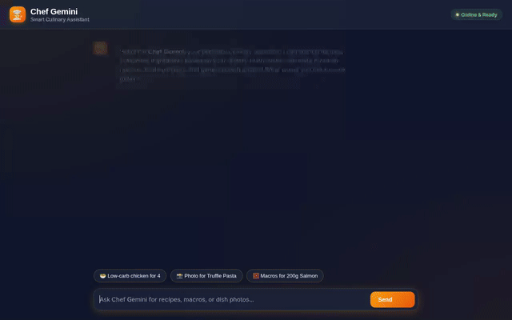

# Chef Gemini — Smart Culinary Assistant

Chef Gemini is an intelligent, conversational agent designed to help home cooks plan meals, discover recipes, customize dishes based on dietary preferences, calculate precise nutritional macros, generate dish visuals, and manage their personal recipe library.



---

## 🌟 Key Features & Capabilities

- 🥗 **Smart Recipe Search & Scaler**: Search recipes in Firestore or fetch online dishes via TheMealDB API, with dynamic portion and ingredient scaling.
- 📸 **AI Dish Visuals (Imagen 3)**: Generate presentation photos for any dish using Google's `imagen-3.0-generate-002` model, automatically uploaded to public Cloud Storage.
- 🎥 **Culinary Video Generation (Google Omni)**: Generate short cooking videos using Google's `gemini-omni-flash-preview` model in the `global` region.
- 🧮 **Nutritional Macro Calculator**: Execute Python code in an isolated Agent Engine Sandbox to perform precise nutritional macro calculations.
- 🧠 **Cross-Session Memory**: Store dietary restrictions, food allergies, and preferences across sessions using Vertex AI Memory Bank.
- 🎴 **A2UI Visual Cards**: Display interactive, structured component cards (Card, Column, Row, Text, Image) rendered natively in the frontend.

---

## 🏗️ Architecture & Cloud Infrastructure

The application is built with the **Google Agent Development Kit (ADK)** and deployed on Google Cloud Platform:

```
[ User Browser ]
       │
       ▼ (HTTP)
[ FastAPI Proxy ]  ──(A2A Protocol)──►  [ Agent Runtime on Vertex AI ]
                                                    │
       ┌───────────────────┬────────────────────────┼───────────────────┬───────────────────┐
       ▼                   ▼                        ▼                   ▼                   ▼
[ Memory Bank ]     [ Firestore DB ]        [ Cloud Storage ]       [ Sandbox ]      [ TheMealDB API ]
  (User Facts)       (Recipe Data)           (Public Media)       (Macro Math)        (Recipe Search)
```

### Google Cloud Services & Technologies Wired Up:
- **Google Agent Development Kit (ADK)**: Framework defining agent instructions, tools, callbacks, and A2UI schema manager.
- **Vertex AI Agent Runtime (Agent Engine)**: Serverless agent execution container deployed in `us-east1`.
- **Vertex AI Memory Bank**: Cross-session memory service maintaining long-term user dietary facts and allergy constraints.
- **Google Cloud Firestore**: Document database storing personal recipe collections.
- **Google Cloud Storage**: Public bucket (`chef-gemini-media-*`) hosting generated dish photos and videos.
- **Vertex AI Imagen 3**: Text-to-image model for dish food photography.
- **Google Omni Model (`gemini-omni-flash-preview`)**: Multimodal video model for short culinary videos.
- **Agent Engine Sandbox Code Executor**: Secure Python sandbox for custom code execution.
- **A2UI (Agent-to-User Interface v0.8)**: Declarative UI schema for generating rich cards inside chat replies.
- **FastAPI & A2A Proxy**: Custom web server forwarding browser user requests over A2A protocol to Agent Engine.

---

## 🛠️ Project Structure

```
chef-gemini/
├── app/
│   ├── agent.py               # Core ADK agent configuration, instruction, and tool bindings
│   ├── firestore_tools.py     # Firestore CRUD, Imagen 3 photo gen, Omni video gen, and TheMealDB tools
│   └── a2ui_utils.py          # A2UI after_model_callback renderer
├── frontend/
│   ├── main.py                # FastAPI proxy server (A2A protocol bridge)
│   └── static/
│       └── index.html         # Responsive chat UI with native A2UI card renderer
├── agents-cli-manifest.yaml   # Deployment manifest for agents-cli
├── deployment_metadata.json   # Deployed Agent Runtime resource metadata
├── demo.gif                   # Inline demo recording of the web interface
└── README.md                  # Project documentation
```

---

## 🚦 Local Setup & Running Instructions

### Prerequisites
- Python 3.11+
- Google Cloud SDK (`gcloud`) authenticated to your GCP project
- Node.js 18+ (optional, for Playwright recording)

### 1. Install Agent Dependencies
```bash
python -m venv .venv
source .venv/bin/activate
pip install -r app/requirements.txt
```

### 2. Run the Agent Locally (ADK Web Playground)
```bash
adk web --port 8000
```
Open `http://localhost:8000/dev-ui/?app=app` in your browser.

### 3. Run the Custom Web Frontend
```bash
cd frontend
pip install -r requirements.txt

# Set deployment metadata environment variables
export AGENT_ENGINE_RESOURCE_NAME="<your-agent-engine-resource-name>"
export AGENT_DIRECTORY="app"

python main.py
```
Open `http://localhost:8080` in your browser to interact with Chef Gemini.

---

## 📌 Implementation Status

| Feature / Service | Status | Description |
|---|---|---|
| **Recipe Search & Scale** | ✅ Implemented | Firestore & TheMealDB recipe lookup with scaling |
| **Imagen 3 Photo Gen** | ✅ Implemented | Plating visuals uploaded to public Cloud Storage |
| **Google Omni Video Gen** | ✅ Implemented | Cooking videos generated via `gemini-omni-flash-preview` |
| **Vertex AI Memory Bank** | ✅ Implemented | Persistent dietary preferences across chat sessions |
| **Agent Engine Sandbox** | ✅ Implemented | Python code execution for nutrition calculations |
| **A2UI Visual Cards** | ✅ Implemented | Structured card rendering in custom chat frontend |
| **Native Mobile App** | 🟡 Planned | Native iOS/Android wrapper (Planned, not yet implemented) |
